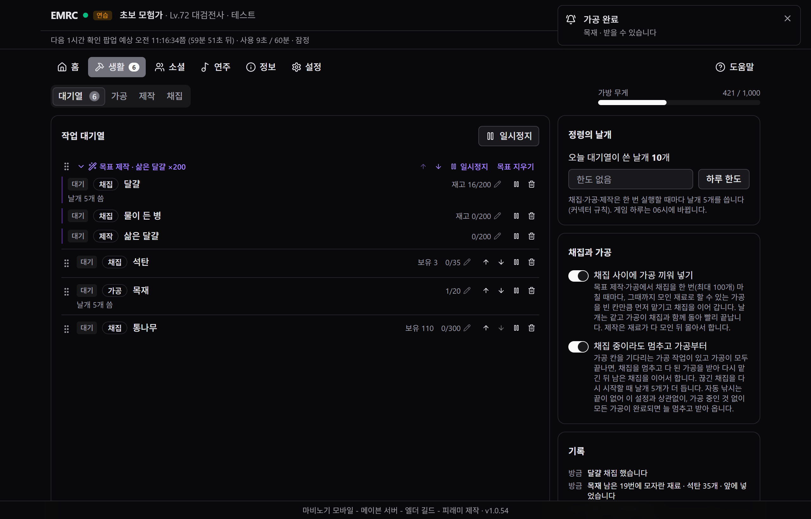
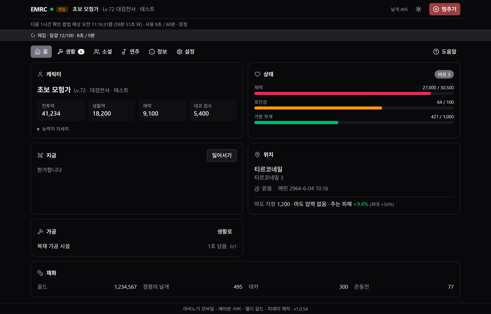
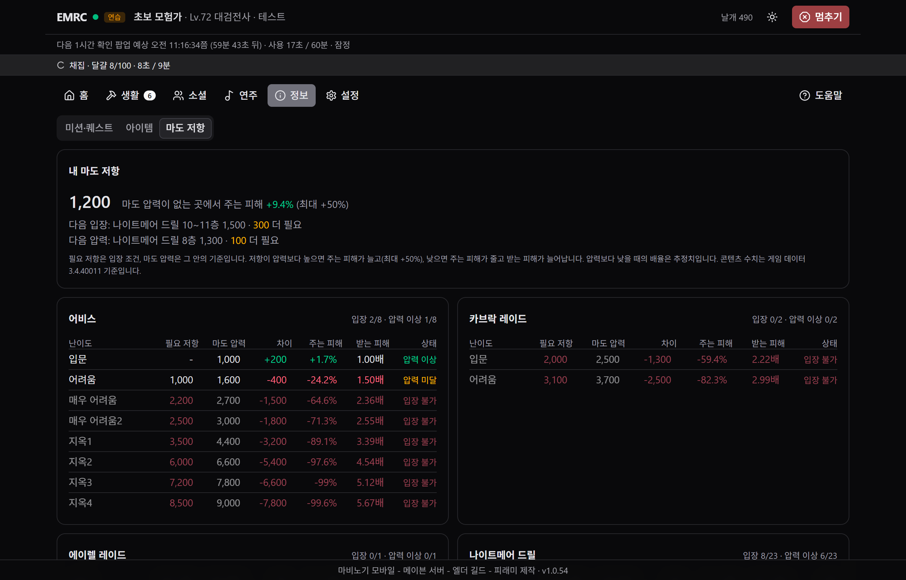
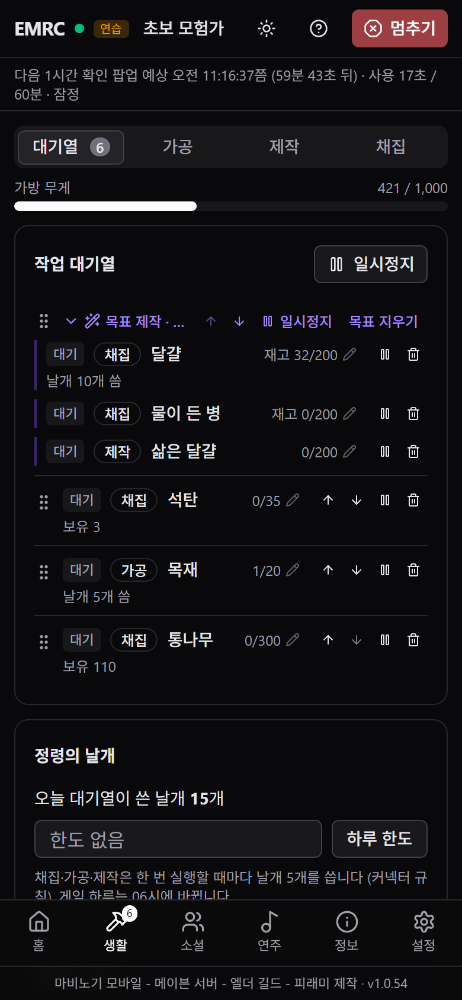

<div align="center">

# EMRC

**Elder Mobinogi Remote Controller**

마비노기 모바일의 채집 → 가공 → 제작을 대기열에 줄 세워 두면 알아서 차례로 돌립니다.<br>
게임 **공식 AI 커넥터**만 씁니다. 패킷 캡처·메모리 읽기·화면 매크로는 쓰지 않습니다.

[](https://github.com/DrFREEST/emrc-releases/releases/latest)


**[⬇ EMRC.exe 받기](https://github.com/DrFREEST/emrc-releases/releases/latest)** · 설치 없이 실행



</div>

> [!IMPORTANT]
> EMRC는 개인이 만든 비공식 도구이며 넥슨·데브캣과 관계가 없습니다. 게임이 제공하는 AI 커넥터 기능을 그대로 부를 뿐이지만, 사용에 따른 책임은 사용하는 분께 있습니다. 게임 운영정책과 AI 커넥터 공지를 먼저 읽어 주세요. 공지는 이 기능을 손이 가는 일을 덜어 주는 용도로 안내합니다.

## 목차

- [무엇을 해 주나요](#무엇을-해-주나요)
- [시작하기](#시작하기)
- [정령의 날개와 1시간 확인 팝업](#정령의-날개와-1시간-확인-팝업)
- [폰으로 쓰기](#폰으로-쓰기)
- [업데이트와 파일 확인](#업데이트와-파일-확인)
- [내 정보는 어디에](#내-정보는-어디에)
- [자주 묻는 질문](#자주-묻는-질문)

## 무엇을 해 주나요

### 작업 대기열

- 가공·제작·채집 목록에서 항목을 찾아 개수를 넣으면 대기열에 줄 섭니다. 위에서부터 차례로 합니다.
- 가공 칸이 차면 비기를 기다렸다 더 맡기고, 다 된 가공은 받아 옵니다. 채집 사이사이에 할 수 있는 가공을 끼워 넣어, 날개는 같고 시간은 줄어듭니다.
- 순서는 끌어서 바꾸고, 항목별로나 대기열 전체로 일시정지할 수 있습니다. 진행 숫자를 누르면 목표 개수를 바로 고칠 수 있습니다.
- 목록 검색은 레시피 이름이나 모자란 재료 이름으로, 입력하는 대로 걸러집니다.

### 목표 제작·가공 (재료부터 모으기)

재료가 모자란 레시피에서 **재료부터**를 누르면, 모자란 재료를 채집 → 가공 → 제작 순으로 풀어 한 묶음으로 넣습니다. 예상 날개 수도 미리 보여 줍니다.

- 목표 안의 채집 단계는 **재고 기준**으로 셉니다. 대기열을 멈추고 직접 모은 것도 들어가고, 중간에 팔아서 줄면 그만큼 다시 모읍니다.
- 처음 만드는 레시피는 첫 1번 전후의 재고를 비교해 1번에 드는 재료 수를 잽니다. 그다음 남은 횟수에 모자란 만큼을 앞에 넣습니다.
- 드롭·상점에서만 얻는 재료는 ‘직접 구해야 하는 재료’로 알려 주고, 그 단계에서 기다립니다.

### 끊겨도 알아서 이어서

- 몬스터 공격이나 게임 창 클릭 등으로 채집이 끊기면, 다음 항목으로 넘어가지 않고 **같은 항목을 잠시 뒤 다시** 합니다.
- 가방·메뉴 같은 창이 게임 화면을 가리면 기다렸다가, **창을 닫으면 저절로 이어서** 합니다.
- 채집하며 함께 들어온 다른 재료(예: 황금 네잎클로버를 캐다 얻는 물이 든 병)는 그 재료의 대기열 항목에 바로 더합니다. 채집 중과 일시정지 중에는 1.5초마다 가방·창고를 읽어 수량을 맞춥니다.
- 낚시로만 나는 물고기는 낚시터로 가서 자동 낚시를 켜고, 목표만큼 잡으면 멈춥니다.

### 한눈에 보기

| 홈 | 마도 저항 |
|---|---|
|  |  마도 저항: 콘텐츠별 필요 저항과 내 저항 비교" width="440"> |
| 캐릭터, 체력·포만감·가방 무게, 지금 하는 일, 위치·날씨, 재화 | 내 마도 저항과 콘텐츠·난이도별 필요 저항, 주는·받는 피해 |

- **정보:** 일일·주간 미션, 퀘스트 트래커, 아이템(가방·계정 창고·캐릭터 창고), 마도 저항
- **소셜·연주:** 채팅·행동·표정 보내기(게임 확인 창을 거침), 주변 사람·NPC, 악기 장착, 악보 연주
- **알림:** 작업 완료·멈춤과 가공 완료를 화면·진동·소리로 알립니다. 원하면 디스코드 채널로도 보냅니다.

<sub>스크린샷은 가짜 데이터로 띄운 연습 모드 화면입니다(왼쪽 위 ‘연습’ 표시).</sub>

## 시작하기

1. **게임에서 커넥터 켜기:** 마비노기 모바일 PC 클라이언트에서 설정 > 게임 > **Mabinogi Mobile AI Connector**를 켭니다.
2. **받아서 실행:** [Releases](https://github.com/DrFREEST/emrc-releases/releases/latest)에서 `EMRC.exe`를 받습니다. 바탕 화면이나 문서 폴더처럼 쓰기 권한이 있는 곳에 두고 실행합니다. 설치 과정은 없습니다.
3. **연결 확인:** 게임에 로그인한 채로 EMRC 왼쪽 위의 점이 **초록**이면 연결된 것입니다. 빨간 점이면 그 옆에 이유가 나옵니다.

> [!NOTE]
> - 코드 서명이 없는 exe라서 처음 실행할 때 Windows SmartScreen이 막을 수 있습니다. **추가 정보 → 실행**을 누르면 됩니다. 받은 파일이 맞는지는 [아래](#업데이트와-파일-확인)처럼 확인할 수 있습니다.
> - 화면은 Windows의 WebView2(Edge)로 그립니다. Windows 10·11에는 보통 이미 들어 있습니다.
> - 게임 공식 가이드에 따르면 커넥터를 켠 뒤 **7일 동안 쓰지 않으면** 옵션이 자동으로 꺼집니다. 한동안 안 쓰다가 연결이 안 되면 이 옵션부터 확인해 주세요.

사용법과 자주 묻는 질문은 EMRC 오른쪽 위 **도움말**에 더 자세히 있습니다.

## 정령의 날개와 1시간 확인 팝업

- **날개:** 채집·가공·제작은 **한 번 실행할 때마다 정령의 날개 5개**가 듭니다. 게임 커넥터의 규칙입니다.
  - 채집은 한 번에 최대 100개를 모읍니다.
  - 제작은 시설이 허락하는 만큼(보통 10개) 묶어서 맡깁니다.
  - 가공 받기·채팅·연주·멈추기는 날개를 쓰지 않습니다.
  - 대기열에서 하루 한도를 정할 수 있습니다.
- **1시간 확인 팝업:** 커넥터로 일을 오래 맡기면 게임이 확인 팝업을 띄웁니다. EMRC는 이 팝업을 **대신 누르지 않습니다**. 팝업이 뜨면 대기열이 기다리고, 게임에서 확인을 누르면 저절로 이어서 합니다.
- **팝업 예상:** 다음 팝업이 뜰 만한 시각을 위쪽에 보여 줍니다. 커넥터가 캐릭터를 움직인 시간이 60분 쌓이는 때를 기준으로 하고, 쉬는 동안에는 쌓인 시간을 조금씩 덜어 냅니다. 로그를 보고 세운 추정이라 어긋날 수 있습니다. 시각을 알려 줄 뿐, 대기열을 멈추거나 쉬게 하지는 않습니다.

## 폰으로 쓰기



설정 > 폰 연결을 켜고, 폰 브라우저로 주소(또는 QR)를 엽니다. 그다음 PC에 보이는 PIN 6자리를 넣습니다.

- **집 와이파이:** 같은 와이파이에 연결된 폰에서 `http://<PC 주소>:42100/`을 엽니다. 처음 켤 때 Windows 방화벽 창이 뜨면 허용합니다.
- **밖에서 (Tailscale, 권장):** PC와 폰에 [Tailscale](https://tailscale.com/)을 같은 계정으로 켭니다. 폰 연결의 ‘Tailscale HTTPS’를 켜면 LTE·5G에서도 https 주소로 열립니다. 같은 Tailscale 네트워크의 기기만 들어올 수 있고, 폰 시스템 알림도 쓸 수 있습니다.
- PIN을 여러 번 틀리면 잠시 로그인을 막습니다. 연결된 폰은 설정 > 연결된 기기에서 끊을 수 있습니다.
- 폰 연결 켜기·끄기와 PIN은 PC 창에서만 바꿀 수 있습니다. EMRC를 닫으면 폰 연결도 끊깁니다.
- 채팅·행동·표정은 게임 화면의 확인 창을 눌러야 보내집니다. 그래서 PC 앞에 없을 때는 쓸 수 없습니다.

<br clear="right">

## 업데이트와 파일 확인

- EMRC는 켤 때와 6시간마다 이 저장소에 새 버전이 있는지 확인합니다.
  - 설정 > 업데이트에서 알림만 받을지, 대기열이 쉴 때 자동으로 설치할지 고를 수 있습니다.
  - 내려받은 파일은 릴리스의 `SHA256SUMS`와 맞는지 확인한 뒤에만 바꿉니다.
- 직접 확인하려면 PowerShell에서 아래 명령을 실행합니다. 나온 값이 릴리스의 `SHA256SUMS`와 같으면 맞는 파일입니다.

  ```powershell
  Get-FileHash .\EMRC.exe -Algorithm SHA256
  ```

- 버전마다 바뀐 점은 [Releases](https://github.com/DrFREEST/emrc-releases/releases)와 EMRC의 도움말 > 변경 내역에 있습니다.

## 내 정보는 어디에

- 설정·대기열·로그는 이 PC의 `%APPDATA%\EMRC`에만 저장합니다.
- 밖으로 나가는 연결은 두 가지뿐입니다. GitHub에서 업데이트를 확인할 때와, 디스코드 웹후크를 직접 넣었을 때입니다.
- 게임과는 게임 폴더의 `MabinogiMobile_CLI.exe`(공식 커넥터)로만 주고받습니다.

## 자주 묻는 질문

<details>
<summary><b>게임에 연결이 안 돼요</b></summary>

게임 설정 > 게임에서 **Mabinogi Mobile AI Connector**가 켜져 있는지, 게임에 로그인했는지 확인해 주세요. 이 옵션은 7일 동안 쓰지 않으면 꺼집니다. 게임을 기본 위치가 아닌 곳에 깔았다면, EMRC 설정 > 게임 공식 AI 커넥터에 `MabinogiMobile_CLI.exe` 위치를 넣어 주세요.
</details>

<details>
<summary><b>작업이 ‘멈춤’이 됐어요</b></summary>

항목 아래에 이유가 나옵니다. 가방 무게 초과처럼 게임에서 해결해야 하는 일이면, 해결한 뒤 ↻(다시)를 누릅니다. 게임 화면을 가리는 창이나 공격으로 끊긴 것은 EMRC가 알아서 다시 합니다.
</details>

<details>
<summary><b>채집이 9분에서 끊겨요</b></summary>

커넥터는 행동 하나의 결과를 최대 9분까지 기다립니다. 그 뒤에도 게임에서 채집이 계속되고 있으면, EMRC가 그 회차의 100개까지 이어서 셉니다. 게임에서도 멈췄다면 남은 수량을 다시 맡기는데, 이때 날개 5개가 또 듭니다. 자주 걸리면 캐릭터를 재료가 나는 곳 가까이에 두고 시작해 주세요.
</details>

<details>
<summary><b>같은 이름의 레시피가 두 개 있어요 (은합금괴 등)</b></summary>

커넥터는 레시피를 이름으로만 실행합니다. 둘 중 어느 레시피가 쓰일지는 게임이 정하고, EMRC는 고를 수 없습니다.
</details>

<details>
<summary><b>업데이트가 안 돼요</b></summary>

대기열이 일하는 중에는 설치하지 않습니다. `EMRC.exe`가 Program Files처럼 쓰기 권한이 없는 폴더에 있으면 파일을 바꾸지 못합니다. 바탕 화면이나 문서 폴더에 두고 써 주세요.
</details>

---

<div align="center">
<sub>마비노기 모바일 - 메이븐 서버 - 엘더 길드 - 피래미 제작</sub><br>
<sub>마비노기 모바일은 넥슨의 게임이며, 게임 이름과 관련 권리는 넥슨에 있습니다. 이 저장소에는 실행 파일만 올라가며, 소스 코드는 없습니다.</sub>
</div>
